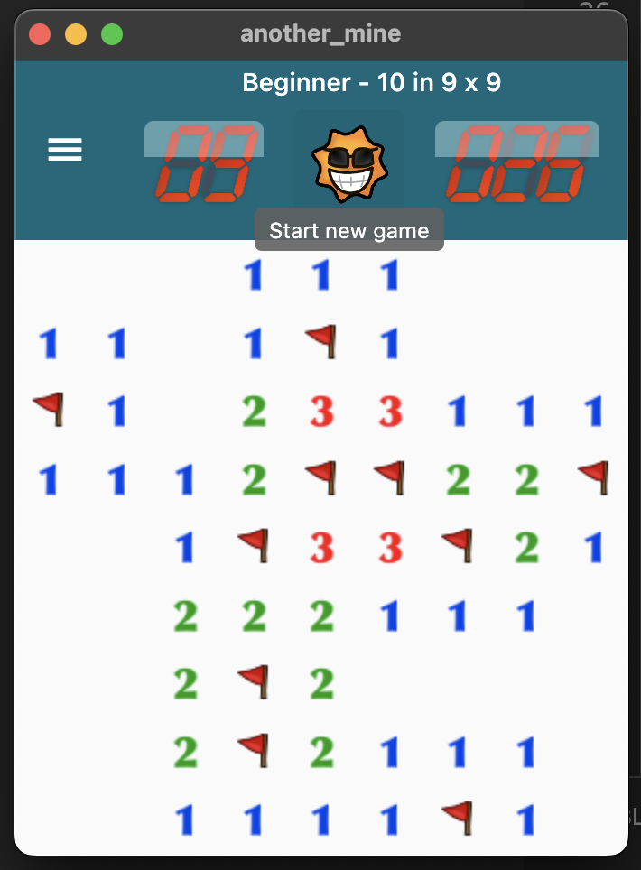

# Another Mine

A modern, cross-platform Minesweeper clone built with Flutter.



## Overview

Another Mine is a fully featured implementation of the classic Minesweeper game. It brings the familiar logic to mobile, web, and desktop platforms using Flutter, enhanced with an Autosolver AI and a clean, responsive UI.

## Features

-   **Classic Gameplay**: Familiar Minesweeper rules and mechanics.
-   **Difficulty Levels**:
    -   **Beginner**: 9x9 grid, 10 mines.
    -   **Intermediate**: 16x16 grid, 40 mines.
    -   **Expert**: 30x16 grid, 99 mines.
-   **Autosolver AI**: A built-in probabilistic solver that can play the game for you or provide hints.
-   **Cross-Platform**: Runs on Android, iOS, macOS, Windows, Linux, and Web.
-   **Responsive Design**: scales to fit different screen sizes.
-   **Game State Management**: Robust state handling using `flutter_bloc`.

## AI Solvers

The game includes two auto-solver strategies located in `packages/client_common/lib/ai/`:

### Simple Guesser
A heuristic-based solver that uses standard Minesweeper logic rules. It scans the board for revealed numbers and applies two primary tactics:
1.  **Flagging**: If the number of unrevealed neighbors equals the tile's value (minus existing flags), all unrevealed neighbors are mines.
2.  **Clearing**: If the number of flagged neighbors equals the tile's value, all other unrevealed neighbors are safe.
If no logical moves are found, it makes a random guess.

### Probability Guesser
An advanced solver that uses constraint satisfaction and probability calculation.
1.  **Certainty**: Prioritizes moves with 100% certainty (safe or mine) derived from global board constraints.
2.  **Probability**: If no certain moves exist, it calculates the mine probability for every unrevealed tile and picks the safest one (lowest probability).
This solver is significantly more effective than the Simple Guesser, especially in complex end-game situations.

## Tech Stack

-   **Mobile and desktop**: [Flutter](https://flutter.dev/)
-   **Web**: [Jaspr](https://docs.page/schultek/jaspr) with Bootstrap, hosting the Flutter game board through `jaspr_flutter_embed`
-   **State Management**: [bloc](https://pub.dev/packages/bloc) (and [flutter_bloc](https://pub.dev/packages/flutter_bloc) on Flutter)
-   **Navigation**: [go_router](https://pub.dev/packages/go_router) on Flutter, [jaspr_router](https://pub.dev/packages/jaspr_router) on the web
-   **Equality**: [equatable](https://pub.dev/packages/equatable)
-   **Logging**: [logging](https://pub.dev/packages/logging)
-   **Local Storage**: [shared_preferences](https://pub.dev/packages/shared_preferences) on Flutter, `localStorage` on the web
-   **Apple platforms**: Swift Package Manager (no CocoaPods)

## Getting Started

### Prerequisites

-   [Flutter SDK](https://docs.flutter.dev/get-started/install) 3.47 or later (Dart 3.13).
-   [Jaspr CLI](https://docs.page/schultek/jaspr/get_started/installation) 0.23.5 or later, for the web client.
-   An IDE (VS Code, Android Studio, or IntelliJ) with Flutter plugins.

### Installation

1.  **Clone the repository:**

    ```bash
    git clone https://github.com/billy1380/another_mine.git
    cd another_mine
    ```

2.  **Install dependencies** for every package in the workspace:

    ```bash
    flutter pub get
    ```

3.  **Run the Flutter app:**

    ```bash
    cd packages/client_flutter
    flutter run
    ```

4.  **Run the web app:**

    ```bash
    cd packages/client_web
    jaspr serve --web-port 5468 --proxy-port 5568
    ```

    The app is at http://localhost:8083.

    The timer, mine count, new game button and minefield are the Flutter
    widgets from `client_flutter`, hosted in the Jaspr page through
    `jaspr_flutter_embed`. The sidebar, header, custom game and settings are
    Jaspr.

### Launcher icons

The icon generator is not a project dependency, because it requires a `cli_util` version that the Jaspr CLI cannot share. Install it once and run it from the Flutter client:

```bash
dart pub global activate flutter_launcher_icons
cd packages/client_flutter
dart pub global run flutter_launcher_icons
```

### Tests

```bash
cd packages/client_common && dart test        # engine, no Flutter needed
cd packages/client_flutter && flutter test    # widgets and pages
```

## Project Structure

This is a Dart workspace, laid out like `willshex_triangles`. See
[doc/package_split_plan.md](doc/package_split_plan.md) for how it was split.

-   `packages/client_common` (`another_mine_common`): pure Dart game engine shared by both clients.
    -   `lib/ai/`: the auto solvers.
    -   `lib/bloc/`: the game bloc.
    -   `lib/model/`: tiles, difficulty, `Colour` and `BoardSize`.
    -   `lib/services/`: `Pref` and the `PrefStorage` each client supplies.
    -   `lib/presentation/`: image choice, probability colours, custom game limits and routes used by both UIs.
    -   `lib/embedding/`: publishes the title and actions to a `willshex_embedding` host.
-   `packages/client_flutter` (`another_mine_flutter`): the Flutter app for iOS, Android, macOS, Windows and Linux, and `AnotherMineView` for embedding in Flutter hosts.
-   `packages/client_web` (`another_mine_web`): the Jaspr web app (sidebar, header, custom game, settings), with the game board embedded from `client_flutter`, and `AnotherMineWebView` for embedding in Jaspr hosts.
-   `packages/mine_images` (`mine_images`): the board images, bundled by the Flutter client (which the web client embeds).
